

  

  
  
  
  
  
  


  


  <a href="https://github.com/Wayn-Git/Amethyst"></a>
  <a href="YOUR-REPO-LINK"></a>
  <a href="YOUR-REPO-LINK"></a>


  

  

  refreshed by a GitHub Action every so often, so it's never quite live. idea from <a href="https://github.com/andyruwruw">andyruwruw</a>, who got it from <a href="https://github.com/natemoo-re">natemoo-re</a>


  

  
  
  
  

  

  

every image on this page is generated by <a href="scripts/build_assets.py">scripts/build_assets.py</a>. made by hand, with too much dithering.

